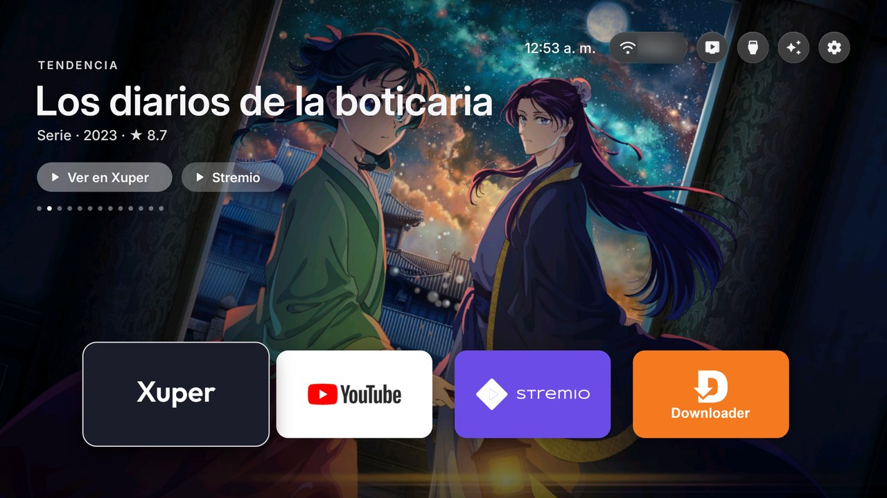
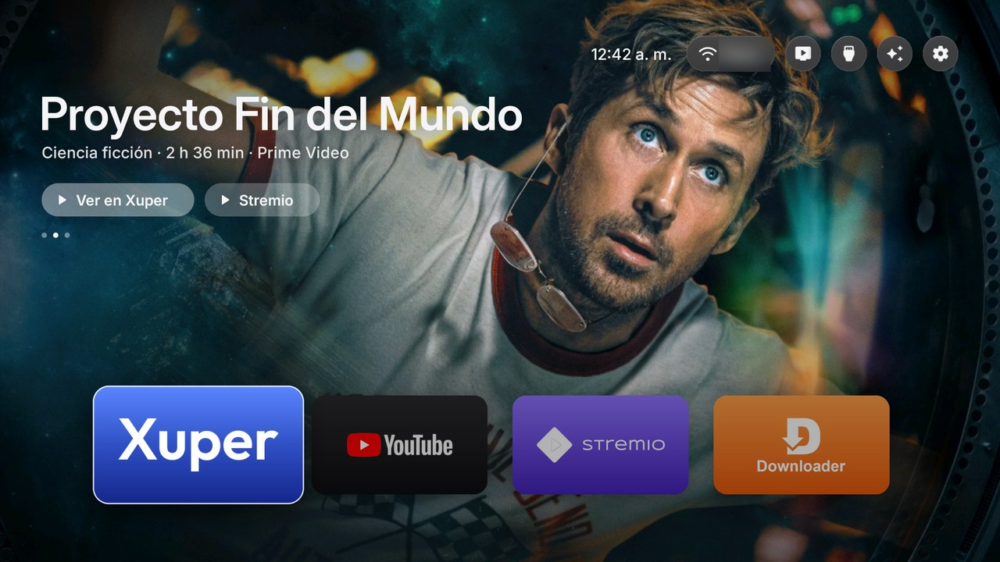
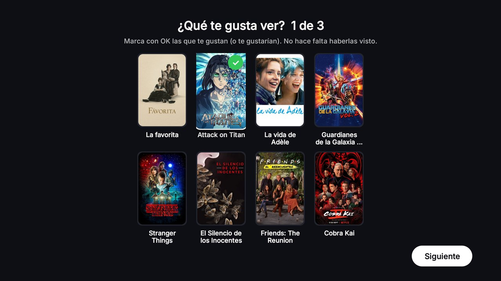
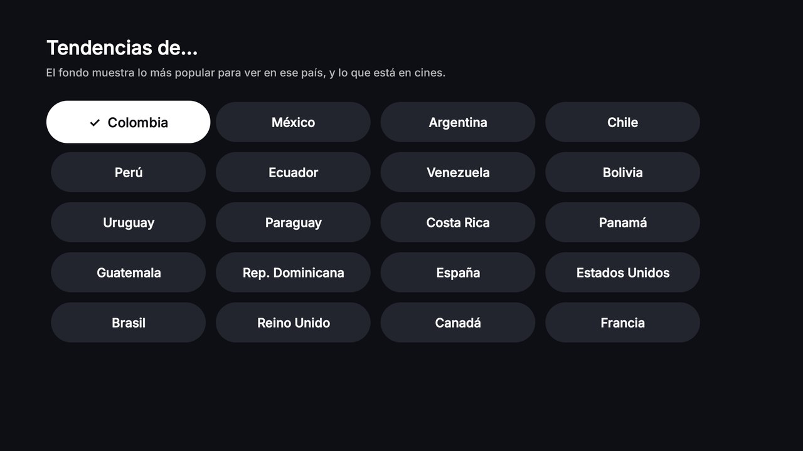
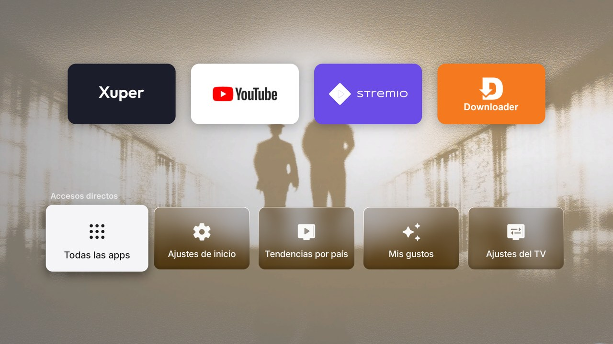
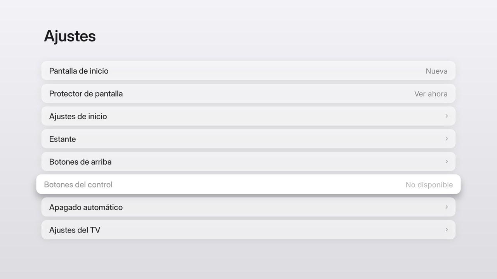
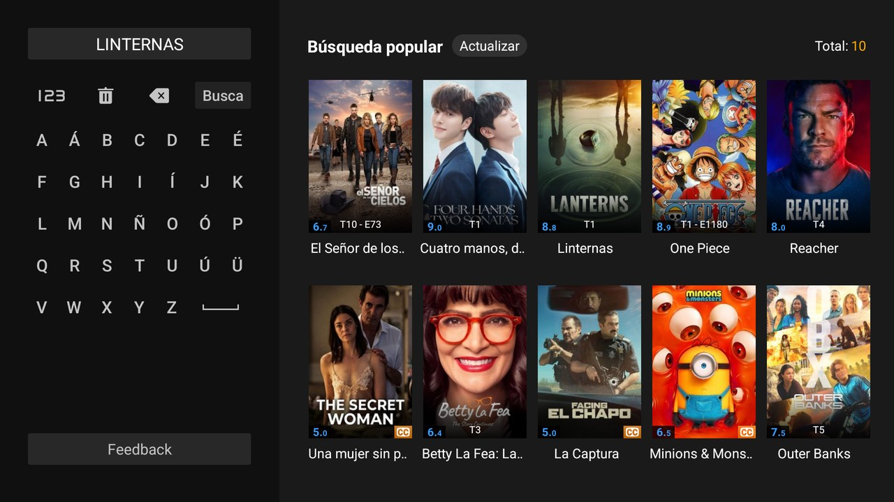
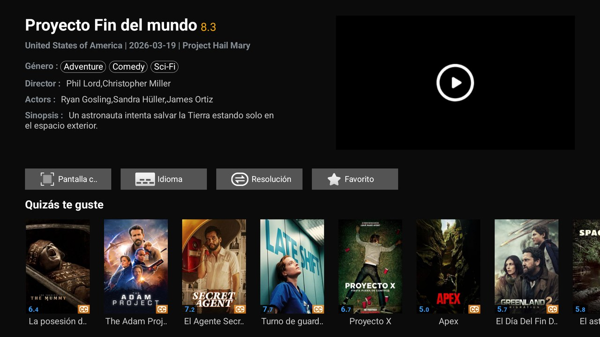

# Apple TV Home for onn

**English** · [Español](#español)

An Apple TV–style home screen for the **onn 4K Streaming Box** (Google TV 14). It's clean and fast, has no ads, and is
built from source in about ten minutes.

Adapted by **[@juandiegoandres](https://github.com/juandiegoandres)** from
[Free My TV](https://github.com/simbasjungles/free-my-tv) (MIT).

| Device | Status |
|---|---|
| onn 4K Streaming Box (2023, Google TV 14) | ✅ Tested |
| onn TV Stick 2K | 🔜 Coming soon |



## What's new compared to Free My TV

- **Full-screen backdrops, Apple TV style.** Movies and series rotate behind your apps every 15 s, with the title,
  year and rating on top. The title only appears once its image is ready, so you never see a blank screen or a title
  over the wrong picture.
- **Two ways to choose what shows up** (press ↓ on the home screen):
  - **Trends by country.** What's popular to watch in Colombia, Mexico, Spain and 17 other countries, plus what's in
    cinemas there.
  - **My tastes.** A three-round test with classics and series that have a clear style, from very different genres:
    documentaries, biographies, horror, comedy, anime and more. Mark what you like and the backdrops follow your
    taste, mixed with new releases and trends.
- **"Watch in <app>" and "Watch in Stremio".** Press ↑ from the apps and the title's buttons open it directly. For an
  app with no links into a title, the button opens it, types the title on the app's own keyboard and opens the
  result. It comes set up for one app and can be pointed at any other with its own search screen (see below).
- **Continue watching:** the last three titles you opened show first in the shortcuts bar (↓) and reopen the same way.
- **Big, flat colour tiles** for your apps, with the focused app's name shown large, as on Apple TV.
- **Top bar:** the time, a Wi-Fi pill showing your network's name (it opens the Wi-Fi settings), and a **Free up
  memory** button that closes background apps and tells you how many MB it freed.
- **Big animated shortcuts bar** (↓): all apps, settings, trends by country, my tastes and TV settings, in a row of large buttons that rise in a cascade, like LG's bar but with Apple's look.
- **Two "no ads" switches in Settings** (each one Yes/No, reversible):
  - **Block ads (DNS).** Android's Private DNS goes through AdGuard and blocks ads and trackers in other apps. DNS
    can't block YouTube's ads, because they come from the same servers as the videos.
  - **YouTube without ads.** Installs [SmartTube](https://github.com/yuliskov/SmartTube), an open-source YouTube
    client for TV with no ads that skips sponsor segments, and puts it on the shelf in YouTube's place. Switch it off
    and YouTube comes back. SmartTube isn't YouTube's official app.
- **Light, full-width settings menu** in Apple TV's light style.
- **Removed:** the weather and crypto cards, the promo rows and the clutter.



| My tastes | Trends by country |
|---|---|
|  |  |

| Shortcuts bar (↓) | Settings |
|---|---|
|  |  |

| "Watch in <app>": the title typed for you | …and the movie, ready to play |
|---|---|
|  |  |

## Lightweight

- **About 2 MB APK.** Plain Java and the Android SDK only: no Gradle, no libraries, no trackers.
- **Twice as fast to Home:** 59 ms against 110 ms for Google TV's stock home, measured on the onn 4K.
- **60 fps** drawing on one canvas. The photos are cached on the box, so they show up instantly after the first time.
- To be honest about memory: with full-screen photos the home screen uses more RAM than the stock one (about 260 MB
  against 135 MB on the onn 4K, which has 2 GB). The **Free up memory** button gives that back when you need it.

## Install (onn 4K)

You need the onn on the same Wi-Fi as a computer (Mac, Linux or Windows).

1. **On the onn:** Settings → System → About → press OK seven times on *Android TV OS build*. Then go back to
   Settings → System → **Developer options** and turn on **USB debugging**. Write down the box's IP address
   (Settings → Network & Internet).
2. **On the computer, install the tools:** a JDK 17, Android's command-line tools (build-tools 34, platform
   android-34) and `adb`. On a Mac:
   ```bash
   brew install --cask temurin@17 android-commandlinetools android-platform-tools
   sdkmanager "build-tools;34.0.0" "platforms;android-34"
   ```
3. **Get the code and set it up:**
   ```bash
   git clone https://github.com/juandiegoandres/appletv-home-onn && cd appletv-home-onn
   ./build.sh            # the first run creates config.properties
   ```
   In `config.properties`, set your city (`latitude`, `longitude`), `tmdb_region` (CO, MX, ES…) and your **TMDB key**.
   The key is free: themoviedb.org → Settings → API → *API Read Access Token*. Keep it private: `config.properties` is
   never committed. Without a key the home screen still works, just without the backdrops.
4. **Build and install:**
   ```bash
   ./build.sh
   adb connect <ONN-IP>:5555          # accept "Allow USB debugging?" on the TV and tick "Always allow"
   adb push FreeMyTV.apk /data/local/tmp/h.apk && adb shell pm install -r /data/local/tmp/h.apk
   ```
5. **Switch on the onn:** open the app → *Home screen* → *New*. The TV asks once more to allow debugging; accept it.
   **Leave USB debugging on**, because the home screen uses it to manage the box.

**Undo everything:** the app → *Home screen* → *Original*. Nothing is uninstalled.

**Things to know:**
- The phone's **Cast button may stop working**, because Google's setup app (which holds the Chromecast credentials)
  gets turned off. In YouTube, use *Link with TV code* instead.
- **If the Wi-Fi was saved during first setup**, the switch asks you to forget the network and join it again first.

## "Watch in <app>"

Some streaming apps have no links into a title. This button opens such an app, taps its search box, types the title on
the app's own on-screen keyboard and opens the first result. Before every step it checks that the right screen is
showing, so it never types into another app.

It comes set up and tested for one app (`app/assets/search-app.json`). To use another app instead:

1. Copy `app/assets/search-app.example.json` over `app/assets/search-app.json`.
2. Fill in your app's package, its activities and the screen positions (on a 1920×1080 screen) of the search button,
   the keyboard, *search* and the first result. The easiest way is to let an AI assistant do it with the prompt below:
   it opens the app, takes screenshots and measures the positions.
3. Build and install again. If you delete that file, you only get the **Stremio** button. If an app update moves its
   screen around, measure the positions again.

## Quick start with an AI assistant

Paste this into **Claude Code, Codex, Gemini CLI or OpenCode**, opened in this folder:

> Install Apple TV Home for onn (this repo) on my onn 4K at `<ONN-IP>`. I live in `<CITY>`. Read README.md and
> AGENTS.md first. Check which tools I'm missing (JDK 17, Android command-line tools, adb) and install only those. Run
> `./build.sh` once to create config.properties and fill in my city and region. Ask me to paste my TMDB key into
> config.properties myself: never ask for it in the chat and never commit it. Build, install it with `adb push` +
> `pm install -r`, and tell me when to accept "Allow USB debugging?" on the TV. Before I switch to the new home screen,
> check `adb shell dumpsys wifi | grep -o 'cname=[^ ]*'`: if `setupwraith` owns my Wi-Fi, tell me to forget it and
> join it again. Check each step with a screenshot from the TV (`adb exec-out screencap -p > shot.png`). Optional: set
> up "Watch in <my app>" for `<APP>` by measuring its search screen with screenshots, and write
> app/assets/search-app.json. Never type keys into an app without first checking it's in the foreground.

## Credits and license

MIT. Based on [Free My TV](https://github.com/simbasjungles/free-my-tv) by its contributors (MIT, see `LICENSE` and
`UPSTREAM-README.md`). Fonts: Inter and Outfit (SIL OFL). Movie and series data from TMDB: *This product uses the TMDB
API but is not endorsed or certified by TMDB.* Not affiliated with Apple, Google or onn/Walmart.

---

# Español

Una pantalla de inicio estilo **Apple TV** para el **onn 4K Streaming Box** (Google TV 14). Es limpia y rápida, no
tiene anuncios y se compila desde el código en unos diez minutos.

Adaptada por **[@juandiegoandres](https://github.com/juandiegoandres)** a partir de
[Free My TV](https://github.com/simbasjungles/free-my-tv) (MIT).

| Aparato | Estado |
|---|---|
| onn 4K Streaming Box (2023, Google TV 14) | ✅ Probado |
| onn TV Stick 2K | 🔜 Próximamente |

## Qué trae de nuevo frente a Free My TV

- **Fondos a pantalla completa, estilo Apple TV.** Películas y series rotan detrás de tus apps cada 15 s, con el
  título, el año y la calificación encima. El título solo aparece cuando su imagen está lista, así que nunca ves la
  pantalla en blanco ni un título sobre la foto equivocada.
- **Dos formas de elegir qué sale** (presiona ↓ en el inicio):
  - **Tendencias por país.** Lo más popular para ver en Colombia, México, España y otros 17 países, más lo que está en
    cines.
  - **Mis gustos.** Una prueba de tres rondas con clásicos y series de estilo marcado, de géneros muy distintos:
    documentales, biografías, terror, comedia, anime y más. Marcas lo que te gusta y los fondos siguen tus gustos,
    mezclados con estrenos y tendencias.
- **«Ver en <app>» y «Ver en Stremio».** Presiona ↑ desde las apps y los botones del título lo abren directamente. Para
  una app sin enlaces a un título, el botón la abre, escribe el título en su teclado y abre el resultado. El
  segundo botón puede manejar cualquier app que tenga su propia pantalla de búsqueda; se configura una vez (ver abajo).
- **Continuar viendo:** los últimos tres títulos que abriste salen primero en la barra de accesos (↓) y se vuelven a abrir igual.
- **Mosaicos grandes de color plano** para tus apps, con el nombre de la app seleccionada en grande, como en Apple TV.
- **Barra superior:** la hora, una píldora de Wi-Fi con el nombre de tu red (abre los ajustes de Wi-Fi) y un botón
  **Liberar memoria** que cierra las apps en segundo plano y te dice cuántos MB liberó.
- **Barra de accesos grande y animada** (↓): todas las apps, ajustes, tendencias por país, mis gustos y ajustes del TV, en una fila de botones grandes que suben en cascada, como la barra de LG pero con el estilo de Apple.
- **Dos interruptores «sin anuncios» en Ajustes** (cada uno Sí/No, reversibles):
  - **Bloquear anuncios (DNS).** El DNS privado de Android pasa por AdGuard y bloquea anuncios y rastreo en otras
    apps. Un DNS no puede bloquear los anuncios de YouTube, porque salen de los mismos servidores que los videos.
  - **YouTube sin anuncios.** Instala [SmartTube](https://github.com/yuliskov/SmartTube), un cliente de YouTube para
    TV de código abierto, sin anuncios y que salta los patrocinios, y lo pone en el estante en lugar de YouTube. Si lo
    apagas, YouTube vuelve. SmartTube no es la app oficial de YouTube.
- **Menú de ajustes claro y de ancho completo**, en el estilo claro de Apple TV.
- **Se quitó:** las tarjetas del clima y de criptomonedas, las filas de promociones y el desorden.

## Liviano

- **APK de unos 2 MB.** Solo Java y el SDK de Android: sin Gradle, sin librerías, sin rastreadores.
- **El doble de rápido al presionar Inicio:** 59 ms frente a 110 ms del inicio original de Google TV, medido en el
  onn 4K.
- **60 fps**, dibujado en un solo lienzo. Las fotos quedan guardadas en el aparato, así que desde la segunda vez
  aparecen al instante.
- Siendo honestos con la memoria: con fotos a pantalla completa, el inicio usa más RAM que el original (unos 260 MB
  frente a 135 MB en el onn 4K, que tiene 2 GB). El botón **Liberar memoria** la recupera cuando la necesitas.

## Instalación (onn 4K)

Necesitas el onn en la misma red Wi-Fi que un computador (Mac, Linux o Windows).

1. **En el onn:** Configuración → Sistema → Acerca de → presiona OK siete veces sobre *Compilación de Android TV OS*.
   Luego vuelve a Configuración → Sistema → **Opciones para desarrolladores** y activa la **Depuración por USB**.
   Anota la IP del aparato (Configuración → Red e Internet).
2. **En el computador, instala las herramientas:** un JDK 17, las herramientas de línea de comandos de Android
   (build-tools 34, plataforma android-34) y `adb`. En Mac: los mismos comandos de la sección en inglés.
3. **Descarga el código y configúralo:** `git clone`, luego `./build.sh` (la primera vez crea `config.properties`). En
   `config.properties` pon tu ciudad (`latitude`, `longitude`), `tmdb_region` (CO, MX, ES…) y tu **clave de TMDB**.
   La clave es gratis: themoviedb.org → Settings → API → *API Read Access Token*. Es privada: `config.properties`
   nunca se sube al repositorio. Sin clave el inicio funciona igual, pero sin los fondos.
4. **Compila e instala:** `./build.sh`, luego `adb connect <IP-DEL-ONN>:5555` (acepta «¿Permitir depuración por USB?»
   en la tele y marca «Permitir siempre»), y por último `adb push` + `pm install -r` como en la sección en inglés.
5. **Activa en el onn:** abre la app → *Pantalla de inicio* → *Nueva*. La tele pide permiso de depuración una vez más;
   acéptalo. **Deja la depuración USB encendida**, porque el inicio la usa para manejar el aparato.

**Deshacer todo:** la app → *Pantalla de inicio* → *Original*. No se desinstala nada.

**Ten en cuenta:**
- **El botón de transmitir del celular puede dejar de funcionar**, porque se apaga la app de configuración de Google,
  que guarda las credenciales de Chromecast. En YouTube usa *Vincular con código de TV*.
- **Si el Wi-Fi se guardó durante la configuración inicial**, el cambio te pide primero olvidar la red y volver a
  conectarte.

## «Ver en <app>»

Algunas apps de streaming no tienen enlaces directos a un título. Este botón abre esa app, toca su buscador, escribe
el título en el teclado de la propia app y abre el primer resultado. Antes de cada paso revisa que esté en la
pantalla correcta, así que nunca escribe en otra app.

Viene configurada y probada para una app (`app/assets/search-app.json`). Para usar otra app:

1. Copia `app/assets/search-app.example.json` encima de `app/assets/search-app.json`.
2. Llena el paquete de tu app, sus actividades y las posiciones en pantalla (en 1920×1080) del botón de búsqueda, el
   teclado, *buscar* y el primer resultado. Lo más fácil es pedírselo a un asistente de IA con el prompt de arriba: él
   abre la app, toma capturas y mide las posiciones.
3. Compila e instala de nuevo. Si borras ese archivo, solo aparece el botón **Stremio**. Si una actualización de la app
   mueve su pantalla, vuelve a medir las posiciones.

## Inicio rápido con un asistente de IA

Pega el prompt de la sección en inglés en **Claude Code, Codex, Gemini CLI u OpenCode**, abierto en esta carpeta, y
agrega al final «Respóndeme en español».

## Créditos y licencia

MIT. Basado en [Free My TV](https://github.com/simbasjungles/free-my-tv) de sus colaboradores (MIT, ver `LICENSE` y
`UPSTREAM-README.md`). Fuentes: Inter y Outfit (SIL OFL). Datos de películas y series de TMDB: *Este producto usa la
API de TMDB, sin respaldo ni certificación de TMDB.* Sin relación con Apple, Google ni onn/Walmart.
